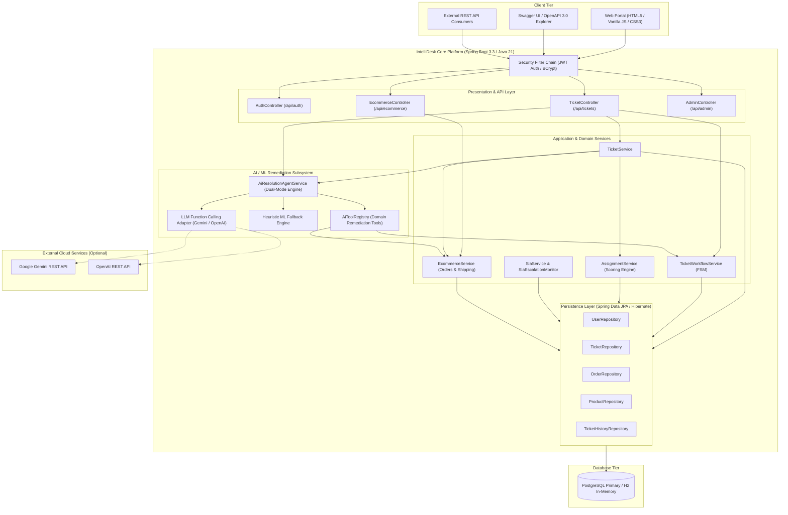
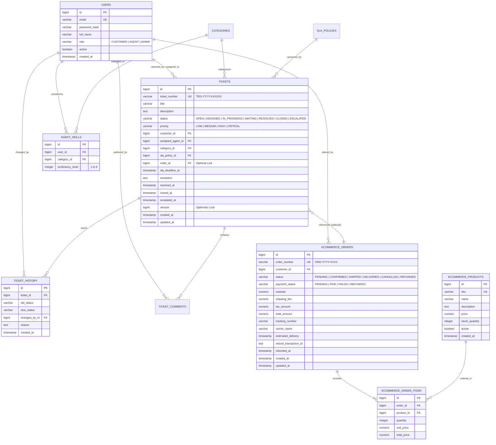
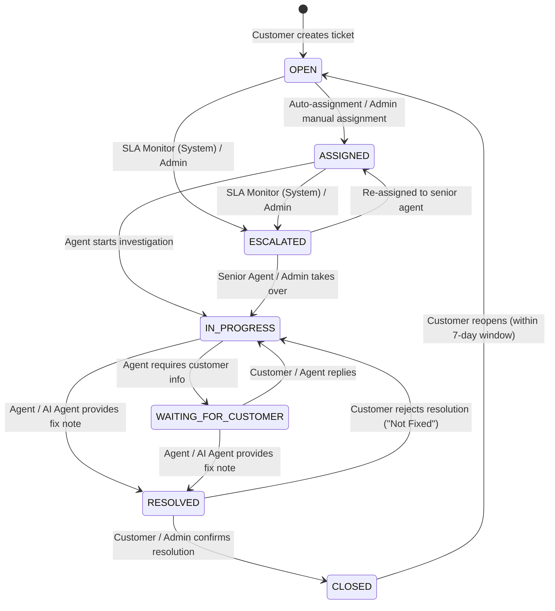
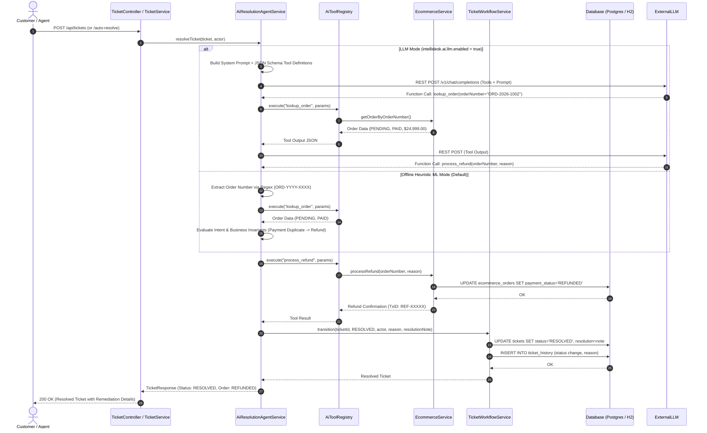
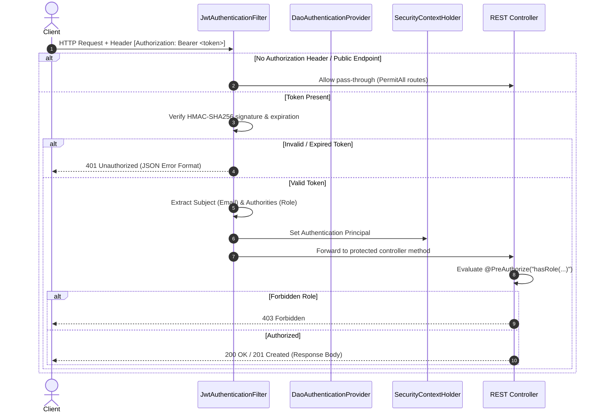

# IntelliDesk: Architecture & System Design Specification

---

## 1. Executive Summary & System Overview

**IntelliDesk** is an enterprise-grade, AI-assisted customer support and ticket management platform engineered in **Java 21** using **Spring Boot 3.3**, integrated with an embedded **E-Commerce Platform** and an **Autonomous AI/ML Remediation Agent**.

### Core Objectives
1. **End-to-End Ticket Lifecycle Management**: Strict finite state machine workflow with append-only audit trails, optimistic concurrency locking, and role-based transitions.
2. **Deterministic Agent Assignment**: Explainable multi-factor scoring model routing incoming issues to the optimal support engineer based on domain proficiency, active workload, and SLA urgency.
3. **Automated SLA Monitoring & Escalation**: Idempotent scheduled engine monitoring time-to-resolution deadlines and escalating breached tickets automatically without duplicate alerts.
4. **Deep E-Commerce Domain Integration**: Embedded catalog, customer orders, line items, and live carrier tracking linked seamlessly with support tickets.
5. **Dual-Mode AI Issue Resolution Agent**: An active tool-calling domain agent that analyzes customer issues, extracts intent and entities, and executes real stateful remediations (refunds, cancellations, carrier tracking synchronization, and goodwill vouchers) in either zero-configuration offline ML mode or external LLM mode (Google Gemini / OpenAI).
6. **Minimalist Polymorphic Web Interface**: A modern, high-contrast light theme built with smooth spring micro-animations, pure white backgrounds, deep charcoal typography, and custom SVG vector icons.

---

## 2. System Context & Container Architecture

The system follows a modular monolith architecture with clean bounded contexts, designed for high cohesion, transactional integrity, and low deployment friction.



---

## 3. Core Domain Model & Entity-Relationship Design

The relational schema is normalized with foreign-key constraints, audit metadata, and optimistic locking version counters.



---

## 4. Controlled Ticket Workflow State Machine

The workflow is enforced through the [`TicketWorkflowService`](file:///c:/ticket/Ticket_Management_System-main/src/main/java/com/intellidesk/ticket/service/TicketWorkflowService.java). Every state transition validates:
1. **Edge Existence**: The transition must be a valid directed edge in the finite state machine.
2. **Actor Authorization**: The caller's role (`CUSTOMER`, `AGENT`, `ADMIN`, `SYSTEM`) must be permitted to execute that specific transition.
3. **Payload Invariants**: Specific edges require explanatory context (e.g., transitioning to `RESOLVED` requires a non-empty resolution note).
4. **Transactional Audit Logging**: Transitioning writes an immutable row to `ticket_history` in the same transaction.



### Transition Authority Matrix

| Transition | Permitted Actors | Preconditions & Side Effects |
|---|---|---|
| `OPEN` &rarr; `ASSIGNED` | `ADMIN`, `SYSTEM` (Auto-Assign) | Assigns agent ID, writes assignment audit record |
| `ASSIGNED` &rarr; `IN_PROGRESS` | Assigned `AGENT`, `ADMIN` | Marks ticket actively being worked on |
| `IN_PROGRESS` &harr; `WAITING_FOR_CUSTOMER` | Assigned `AGENT`, `ADMIN` | Suspends active SLA countdown expectation |
| `IN_PROGRESS` &rarr; `RESOLVED` | Assigned `AGENT`, `ADMIN`, `SYSTEM` (AI Agent) | **Requires resolution note**; stamps `resolvedAt` |
| `RESOLVED` &rarr; `CLOSED` | Ticket Owner (`CUSTOMER`), `ADMIN` | Stamps `closedAt` |
| `RESOLVED` &rarr; `IN_PROGRESS` | Ticket Owner (`CUSTOMER`) | Customer reports fix did not work |
| `CLOSED` &rarr; `OPEN` | Ticket Owner (`CUSTOMER`), `ADMIN` | Permitted only within 7 days of closure; clears agent and resolution |
| Any Active &rarr; `ESCALATED` | `SYSTEM` (SLA Monitor), `ADMIN` | Stamps `escalatedAt`; triggers priority queue notification |

---

## 5. Dual-Mode AI Remediation Agent Architecture

The AI subsystem moves beyond simple text classification into an **active operational agent** capable of remediating real system state.



### Executable Domain Tools ([`AiToolRegistry`](file:///c:/ticket/Ticket_Management_System-main/src/main/java/com/intellidesk/ai/resolution/AiToolRegistry.java))

| Tool Name | Parameters | Domain Action | Invariant Guards |
|---|---|---|---|
| `lookup_order` | `orderNumber` (string) | Retrieves order totals, statuses, tracking details, and item records | Must belong to ticket owner unless caller is AGENT/ADMIN |
| `process_refund` | `orderNumber`, `reason`, `amount` | Mutates order payment status to `REFUNDED`; generates refund transaction ID | Fails if payment is already `REFUNDED` or order is unpaid |
| `cancel_order` | `orderNumber`, `reason` | Cancels pending order and initiates automatic payment reversal | **Guarded**: Blocks cancellation if status is `SHIPPED` or `DELIVERED` (instructs return flow) |
| `sync_tracking` | `orderNumber` | Interrogates carrier tracking gateway and updates real-time tracking status | Requires active carrier tracking number |
| `issue_store_credit`| `orderNumber`, `amount`, `reason` | Generates customer goodwill compensation credit voucher (`CREDIT-XXXXXXXX`) | Caps goodwill amount against order subtotal |

---

## 6. Smart Agent Assignment Algorithm

When `intellidesk.assignment.auto-assign-on-create=true`, or an Admin triggers `POST /api/tickets/{id}/assign`, candidates are evaluated across a deterministic scoring function.

### Scoring Formula
$$\text{Score}(a) = w_{\text{exp}} \cdot \text{Expertise}(a) + w_{\text{work}} \cdot \text{WorkloadScore}(a) + w_{\text{avail}} \cdot \text{Availability}(a) + \text{Boost}(a)$$

Where:
* **Expertise**: $\frac{\text{ProficiencyLevel}(a, \text{Category})}{5.0} \in [0.0, 1.0]$. Defaults to $0.0$ if the agent has no explicit skill row.
* **WorkloadScore**: $1.0 - \min\left(1.0, \frac{\text{ActiveTickets}(a)}{\text{MaxCapacity}}\right)$, where default $\text{MaxCapacity} = 10$.
* **Availability**: $1.0$ if $\text{ActiveTickets}(a) < \text{MaxCapacity}$, else $0.0$.
* **Priority Boost**:
  * $\text{Priority} = \text{CRITICAL} \implies +0.20$ (if $\text{Expertise} \ge 0.60$)
  * $\text{Priority} = \text{HIGH} \implies +0.10$ (if $\text{Expertise} \ge 0.60$)
* **Weights**: Default configuration sums to $1.0$ ($w_{\text{exp}} = 0.50$, $w_{\text{work}} = 0.30$, $w_{\text{avail}} = 0.20$).

### Determinism Guarantee
In the event of an exact score tie, the candidate with the **lower numeric agent ID** wins. Every auto-assignment generates a comprehensive explanation logged in the ticket audit trail.

---

## 7. SLA Monitoring & Auto-Escalation Engine

Resolution targets are established at ticket creation and stored permanently in `sla_deadline_at`.

| Priority | Resolution Target Policy | At-Risk Warning Window |
|---|---|---|
| **CRITICAL** | 2 Hours | 30 Minutes |
| **HIGH** | 8 Hours | 60 Minutes |
| **MEDIUM** | 24 Hours | 120 Minutes |
| **LOW** | 48 Hours | 240 Minutes |

### SLA Health States (Evaluated at Read Time)
* **`ON_TRACK`**: $\text{CurrentTime} < \text{Deadline} - \text{AtRiskWindow}$
* **`AT_RISK`**: $\text{Deadline} - \text{AtRiskWindow} \le \text{CurrentTime} < \text{Deadline}$
* **`BREACHED`**: $\text{CurrentTime} \ge \text{Deadline}$

### Idempotent Background Monitor
A Spring `@Scheduled` worker scans for active tickets (`OPEN`, `ASSIGNED`, `IN_PROGRESS`, `WAITING_FOR_CUSTOMER`) whose `sla_deadline_at < NOW()`.
* **Idempotency Guard**: Tickets already in status `ESCALATED` are excluded by repository query.
* **Transactional Deduplication**: Audit verification ensures a ticket can never receive more than one breach escalation entry per incident.

---

## 8. Security & Authentication Architecture

Authentication is strictly **stateless JWT** with zero server-side HTTP session state.



---

## 9. Comprehensive REST API Reference

All protected endpoints require the HTTP header `Authorization: Bearer <JWT_TOKEN>`.

### Authentication Endpoints
* `POST /api/auth/register`: Public. Register customer account. Body: `{ email, password, fullName }`. Returns: JWT Token & User details.
* `POST /api/auth/login`: Public. Authenticate user. Body: `{ email, password }`. Returns: JWT Token & User details.
* `GET /api/auth/me`: Authenticated. Returns current authenticated user profile.

### Ticket Lifecycle Endpoints
* `POST /api/tickets`: `CUSTOMER` only. Creates support ticket. Body: `{ title, description, categoryId?, priority?, orderId? }`.
* `GET /api/tickets/{id}`: Owner `CUSTOMER`, Assigned `AGENT`, or `ADMIN`. Full ticket details including embedded `order` summary.
* `GET /api/tickets/my`: `CUSTOMER` only. Paginated listing of caller's tickets.
* `GET /api/tickets/assigned`: `AGENT` only. Paginated listing of agent's assigned tickets.
* `GET /api/tickets?status=&page=&size=`: `ADMIN` only. Paginated listing across all system tickets.
* `PATCH /api/tickets/{id}`: `CUSTOMER` (own OPEN tickets only) or `ADMIN`. Partial updates.
* `POST /api/tickets/{id}/status`: `CUSTOMER`, `AGENT`, `ADMIN`. Enforces workflow transition. Body: `{ target, reason?, resolution? }`.
* `GET /api/tickets/{id}/history`: Owner `CUSTOMER`, Assigned `AGENT`, `ADMIN`. Immutable audit trail.
* `POST /api/tickets/{id}/assign`: `ADMIN` only. Triggers multi-factor scoring auto-assignment.
* `POST /api/tickets/{id}/auto-resolve`: Ticket Owner, Assigned `AGENT`, `ADMIN`. Triggers AI Resolution Agent remediation.

### E-Commerce Integration Endpoints
* `GET /api/ecommerce/products`: Public / Authenticated. Returns active hardware product catalog.
* `GET /api/ecommerce/orders/my`: `CUSTOMER` only. Returns authenticated customer's order history.
* `GET /api/ecommerce/orders`: `AGENT`, `ADMIN`. Returns all orders across the system.
* `GET /api/ecommerce/orders/{id}`: Owner `CUSTOMER`, `AGENT`, `ADMIN`. Order details with line items and tracking.
* `GET /api/ecommerce/orders/by-number/{orderNumber}`: Owner `CUSTOMER`, `AGENT`, `ADMIN`. Lookup by human order number (`ORD-YYYY-XXXX`).

---

## 10. Web Interface & Minimalist Vector Design System

The frontend is a single-page web application (`index.html`, `app.js`, `styles.css`) engineered around a **clean monochromatic light theme** with **SVG vectors**:

* **Color System**: Pure white backdrop (`#ffffff`), subtle off-white card surfaces (`#fafafa`), and high-contrast pitch-charcoal typography (`#09090b`).
* **Motion Design**: Fluid spring easing (`cubic-bezier(0.16, 1, 0.3, 1)`), smooth card hover lifts (`translateY(-3px)`), and spring modal dialog transitions (`scale(0.96) translateY(8px)` &rarr; `scale(1)`).
* **Zero Emoji Vector Design**: 100% vector-based interface using inline SVGs for all components:
  * Brand logo: Geometric lightning vector.
  * Stat cards: 3D multi-tone shaded vectors (Tickets, Active/Open, Resolved, Workload, SLA Alerts).
  * Navigation & Badges: Package, Storefront, Delivery Truck, and AI processor icons.
  * Empty queue states: 52px minimalist vector line illustrations.

---

## 11. Configuration & Deployment Reference

All system configuration is consolidated in [`application.yml`](file:///c:/ticket/Ticket_Management_System-main/src/main/resources/application.yml) and overridable via environment variables.

| Property | Default | Environment Variable | Description |
|---|---|---|---|
| `spring.datasource.url` | Neon PostgreSQL Pooler | `INTELLIDESK_DB_URL` | JDBC database connection URL |
| `spring.datasource.username` | `neondb_owner` | `INTELLIDESK_DB_USERNAME` | Database username |
| `spring.datasource.password` | `npg_W9nOd...` | `INTELLIDESK_DB_PASSWORD` | Database password |
| `intellidesk.security.jwt.secret` | *(configured)* | `INTELLIDESK_JWT_SECRET` | HMAC-SHA256 signing key (&ge; 32 characters) |
| `intellidesk.security.jwt.expiration-minutes` | `60` | `INTELLIDESK_JWT_EXPIRATION_MINUTES` | Token validity duration |
| `intellidesk.ai.llm.enabled` | `false` | `INTELLIDESK_AI_LLM_ENABLED` | Set `true` to enable external LLM calling; `false` runs local heuristic ML |
| `intellidesk.ai.llm.provider` | `gemini` | `INTELLIDESK_AI_LLM_PROVIDER` | `gemini` or `openai` |
| `intellidesk.ai.llm.api-key` | `""` | `INTELLIDESK_AI_API_KEY` | API key for Gemini or OpenAI |
| `intellidesk.ai.llm.model` | `gemini-1.5-flash`| `INTELLIDESK_AI_MODEL` | LLM model identifier |
| `intellidesk.ai.llm.auto-resolve-on-create`| `true`| `INTELLIDESK_AI_AUTO_RESOLVE` | Auto-trigger remediation on ticket creation |
| `intellidesk.assignment.auto-assign-on-create`| `false`| `INTELLIDESK_AUTO_ASSIGN` | Auto-assign ticket on creation |
| `intellidesk.sla.scan-interval-ms` | `60000` | `INTELLIDESK_SLA_SCAN_MS` | SLA background scanner frequency |

---

## 12. Verification & Testing Metrics

The test suite contains **162 automated tests** verifying unit, integration, and security layer contracts:

```text
[INFO] Results:
[INFO] Tests run: 162, Failures: 0, Errors: 0, Skipped: 0
[INFO] BUILD SUCCESS
```

Key test suites:
* **`EcommerceServiceTest`**: Verifies refunds, cancellations, tracking synchronization, store vouchers, and order state invariants.
* **`AiResolutionAgentServiceTest`**: Verifies dual-mode function execution, parameter validation, entity extraction, and fallback behaviors.
* **`TicketWorkflowIntegrationTest`**: Verifies finite state machine edges, actor authority matrix, and SLA escalations.
* **`AssignmentServiceTest`**: Verifies multi-factor scoring formulas, tie-breaking determinism, and workload saturation.
